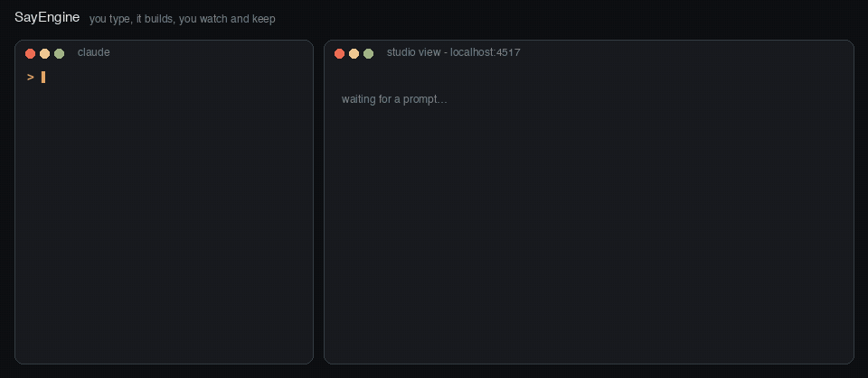

# SayEngine



A little 3D game engine you run with words. You tell Claude Code what you want ("make a spider that scuttles", "the octopus pours tea, slower", "make downtown at night"), it drives the studio's tools, and you watch the result show up in a live view in your browser. Then you keep it, undo it, drag a slider, or point at a thing and say "this, but bigger".

It's built for one person making small games on a laptop. Everything runs locally with free tools. It was made on an 8 GB M2 MacBook Air, so it should run on yours.

## Two front doors

You only need to remember two commands.

### Making a game: `/x-decide-gaming`

Start here when you've got a game idea, even a loose one.

```
/x-decide-gaming a cozy game where you deliver bread at dawn
```

It works out where your game is on the road (concept, design, build or playtest) and takes you to the right step. Each decision comes back as a visual page with four options drawn out, a recommendation and the case against it, and you make the call. Once the calls are made, it builds a first playable with the tools below, then runs playable previews, playtest bots and your typed playtest notes back into the decisions.

`/x-decide-gaming` is the game-making branch of [Decision Kit](https://github.com/jnemargut/decision-kit), a set of planning skills where AI does the busywork around your decisions and you make the calls. If you like how it works here, Decision Kit has the same approach for apps, products and anything else you're planning.

### Making assets: `/studio`

Start here when you want a thing: a stool, a vase, a building, a character, a spider that scuttles.

```
/studio make a ceramic vase about 30 cm tall
/studio make a spider that scuttles
```

Claude builds it step by step while you watch in the live view. Every size is a named parameter you can slide, every change is a step you can keep or undo, and checks catch things like legs not touching the floor. Changes to things that already exist arrive as proposals you review one change at a time. It also exports game assets for Godot and the web, and 3D prints (made for a Bambu A1 mini).

## What's behind the doors

Both front doors call on these. You can also use any of them directly.

- **Characters.** Rigged characters built from body plans: people, dogs, birds, chibis. They have faces, hands and lip sync with a local voice.
- **Animate anything.** Creatures and machines made from rig parts: legs, tentacles, tails, wings, fins and wheels. A spider walks, an octopus pours tea, a bird takes off and lands. One-off actions come from a few key moments, and word notes like "slower, more weight" become edits.
- **Effects and a UI kit.** Fire, sparks, embers, smoke and rain from one effect file that looks the same in Godot and on the web. The UI kit has bars, item slots, buttons, cards and speech bubbles, with contrast and tap-size checks.
- **`/game`.** Turns studio scenes into real games in Godot 4 or three.js, with headless play tests.
- **`/world`.** Towns from open map data (OpenStreetMap, Overture, USGS heights) or invented ones, with landmarks and fixes you make by clicking a building. Pocket Raleigh is the demo.
- **`/look`.** Looks like "day toy" and "night with glow" as data, with sliders and "show me three".
- **`/life`.** Townsfolk with day plans and traffic on lanes, checked by running whole days headless. Click a person to see or change their day.
- **`/sound`.** Synth sound effects, ambience beds, CC0 recordings, Stable Audio Open Small for gaps, and music stems that follow the action. Every file carries its licence.
- **`/reel`.** Trailers cut to the beat, with keep, redo and "show me three" per shot, plus release checks.
- **`/proof`.** Checks a game looks the same in Godot and on the web, and on an imitated phone.
- **The live view.** Home for all of it. Its timeline lets you scrub motions, effects, sounds and shots and point at a moment ("the hand at the impact"). Notes pin to things in one inbox, a taste file remembers your picks, and "your call" cards list the few things only you can judge.

## Try it

You'll need macOS, Node 23.6 or newer, Google Chrome and ffmpeg. Godot 4, Bambu Studio and a Python venv (for beat detection and Stable Audio) are optional.

```bash
git clone https://github.com/jnemargut/sayengine.git
cd sayengine
npm install
npm run build:view
./studio status              # starts the studio in the background
open http://localhost:4517   # the live view
```

Then open Claude Code in this folder and knock on a front door:

```
/x-decide-gaming a tiny game about fixing a lighthouse before the storm
/studio make a spider that scuttles
```

`./studio install-skills` links the game skills into `~/.claude/skills` so `/x-decide-gaming` works in any folder (add `--all` for `/studio` and `/game` too). `./studio help` lists every command.

## Example games

- **`games/fires-dying`**: a 4 minute web game. You're the apprentice: fetch the smith's tools before the forge fire dies. Play it with `cd games/fires-dying && npm run play`.
- **`games/pocket-raleigh`** and **`games/pocket-raleigh-web`**: a toy-sized downtown Raleigh, day and night, with townsfolk, in Godot and on the web.
- **`games/ik-yard`**: creatures with live feet on uneven ground in Godot.

## Things it's not great at yet

- Shapes come from typed operations, not sculpting, and there's no CAD kernel.
- Characters are stylised and come from one kit.
- Recordings from the live view have no sound yet.
- The visual checks lean on macOS (Apple Vision OCR, for one).
- The town view loads a chunk at a time, and only a small cut has been tried in the view so far.

## Demo media

The videos and pictures from every build checkpoint live in a zip on the [checkpoints release](https://github.com/jnemargut/sayengine/releases/tag/checkpoints-2026-11-05). They were taken out of the git history to keep clones small (about 8 MB). Game assets are stored with Git LFS.

## Licence and credits

Apache-2.0, copyright 2026 Jonathan Nemargut. See [LICENSE](LICENSE) and [NOTICE](NOTICE).

The studio uses free, local third-party tools and open data (Kokoro voices, Rhubarb Lip Sync, Roboto, OpenStreetMap and Overture under ODbL, USGS heights, CC0 recordings, and Stable Audio Open Small under the Stability AI Community License). Everything is listed with its licence in [THIRD_PARTY.md](THIRD_PARTY.md). If you ship Stable Audio sounds in a game, show "Powered by Stability AI" where players see it.
